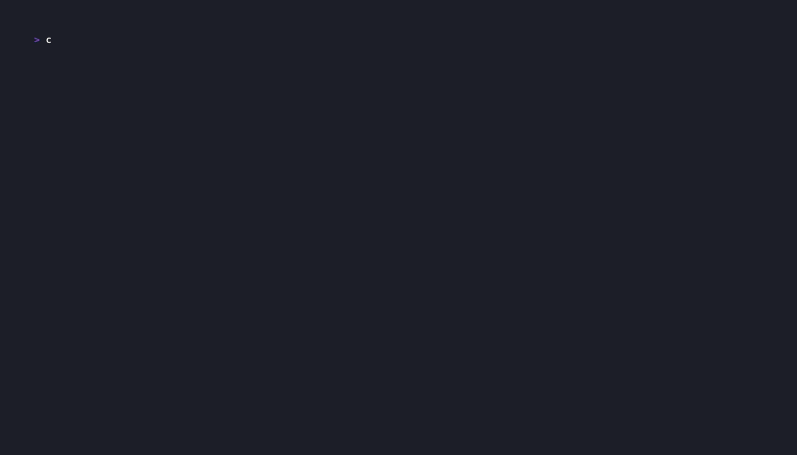

# squint

**squint** — review what your LLM just committed, in a terminal UI.

It shows the last few commits on the current branch and the relevant
parts of the source they changed: commit list, changed files, and a
syntax-highlighted diff in one screen — navigable by keyboard and mouse.
Because sometimes you have to squint at what the machine committed.



The demo is generated from `demo/demo.tape` with
[vhs](https://github.com/charmbracelet/vhs) (plus ffmpeg).

## Try it

```sh
go run ./cmd/squint
```

Requires the `git` binary (≥ 2.20). No configuration files.

## Install

```sh
# go install from a tagged release
go install github.com/smhanov/squint/cmd/squint@latest

# Homebrew (macOS)
brew install smhanov/tap/squint
```

Prebuilt archives for macOS (amd64/arm64), Linux (amd64/arm64, static —
works on glibc and musl), and Windows (amd64/arm64) are attached to each
GitHub release with checksums. Windows users can also add the scoop
bucket: `scoop bucket add smhanov https://github.com/smhanov/scoop-bucket`
and `scoop install squint`.

## What it does

- **Three panes, one screen** — commits on the left; changed files and
  the diff on the right. Selecting a commit shows everything at once.
- **Readable code** — syntax-highlighted diffs (chroma), side-by-side
  mode (`s`), intraline word-diff (`i`), wrap (`w`), context control
  (`+`/`-`), whitespace toggle (`W`).
- **Always current** — squint watches the repository; when your agent
  commits again, the list updates by itself with the selection kept.
- **Zero-friction navigation** — vim keys and full mouse support: wheel
  scrolls, click selects, click a file to jump to its hunk, drag the
  divider to resize. `z` zooms the focused pane; `d` shows everything
  that happened since a commit; `y` copies the hash to the clipboard.
- **Read-only** — squint never mutates a repository.

Run `squint --help` for the complete key reference; `?` inside the app
shows the same table. The [spec](spec.md) is the full requirements
document.

## Development

```sh
go build ./...
go test -race ./...
golangci-lint run
```

Golden-frame tests snapshot the rendered UI under `testdata/golden/`;
rewrite them deliberately with
`go test ./internal/model -run TestGoldenFrames -update`.
The demo GIF is regenerated from `demo/demo.tape` with
[vhs](https://github.com/charmbracelet/vhs).

## License

MIT.
